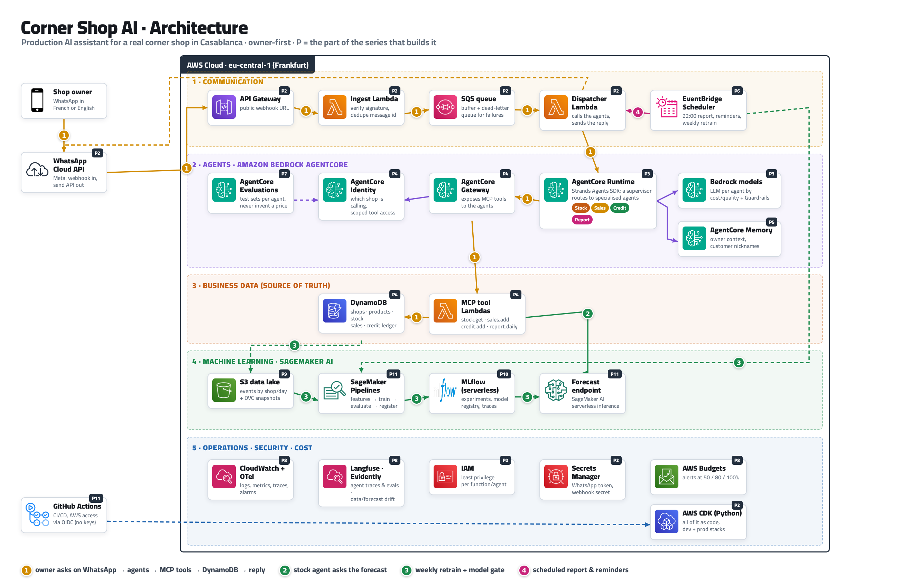

# Corner Shop AI

A production AI assistant for a real corner shop in Casablanca, built in public by **Oz builds AI**.
The owner just asks on WhatsApp (French or English): stock, sales, customer credit, daily reports.
Agents built with **Strands** on **Bedrock AgentCore**, tools through **MCP**, a demand **forecasting model** on
**SageMaker AI**, and **MLOps** to keep it alive. 12 parts, 3 seasons, one real shop, real data. Every part is a video
and a git tag (`part-N`). Nothing is shown as built before it is built.



## Status: Part 3 · The first agent ✅

The owner texts "vendu 2 lait et 1 sucre" and gets an answer back: *Noté : 2 lait et 1 sucre vendus.*

```
SQS FIFO ──► Dispatcher Lambda ──► Bedrock AgentCore Runtime ──► Strands agent ──► Claude Haiku 5.5 (EU)
                 │  store message + what was understood + reply (SHOP#<id>)
                 └─► WhatsApp Cloud API: the reply, as an answer to the owner's message (sent once)
```

- **The agent** (`agent/`): Strands Agents + Claude Haiku 5.5 through the EU inference profile. One message in, a typed
  result out: intent (sale, restock, credit, question, other), items and quantities, credit customer and amount,
  language, and a short reply in the owner's language. It asks when a quantity is missing and never invents numbers.
- **Evaluated on the real model:** `scripts/eval_agent.py` runs 20 French and English messages (sales, deliveries,
  credit, paybacks, questions, a missing quantity): **20/20**.
- **AgentCore Runtime**, deployed by CDK as plain code (no Docker): `scripts/build_agent.py` packages it for arm64.
  The runtime may call only that one model; the dispatcher may call only that one agent.
- **Exactly once:** a redelivered message never asks the agent twice and never sends the reply twice. A failed send is
  retried without asking the agent again.
- **Not yet:** the agent only understands. Stock and credit tools arrive in Part 4 (MCP), memory in Part 5.

## Part 2 · The foundation ✅

Before any AI: the boring part that keeps it alive.

```
WhatsApp ──► API Gateway (HTTP) ──► Ingest Lambda ──► SQS FIFO ──► Dispatcher Lambda ──► DynamoDB
                                      │  verify Meta signature        │ per-shop order      │ store under SHOP#<id>
                                      │  drop duplicates (Meta retries)│ 3 tries ──► DLQ ──► alarm
                                      │  find the shop, answer 200 fast
                                      └─ secrets: Secrets Manager
```

- **Infrastructure as code:** AWS CDK (Python), `dev` and `prod` stacks, region `eu-central-1` (Frankfurt: every
  AgentCore feature the later parts need). Nothing clicked in the console.
- **Multi-tenant from day one:** single table, every shop's data under `SHOP#<shop_id>`. Each Lambda's IAM policy is
  limited to the key prefixes it needs (`dynamodb:LeadingKeys`): ingest reads `PHONE#` and writes `DEDUP#`, the
  dispatcher only writes `SHOP#`. No scans, no deletes.
- **Never lose, never double:** dedupe by WhatsApp message id (conditional write + TTL) and SQS FIFO deduplication;
  idempotent writes; partial batch failures keep per-shop order; dead-letter queue + CloudWatch alarm.
- **Tested:** Part 2 shipped with 19 tests (webhook signature, Meta handshake, retries, unknown numbers, ordering, idempotency) and
  infrastructure assertions (FIFO + DLQ, backups, scoped IAM, partial batch failures).

| Key (pk / sk) | What |
|---|---|
| `SHOP#<id>` / `META` | the shop |
| `PHONE#<phone_number_id>` / `SHOP` | which shop owns a WhatsApp number |
| `SHOP#<id>` / `MSG#<time>#<wamid>` | every inbound message (the raw data the forecasting model learns from later) |
| `DEDUP#<wamid>` / `DEDUP` | seen-message marker, expires after 7 days |

## Run it

```bash
python3 -m venv .venv && . .venv/bin/activate && pip install -e ".[dev]"
pytest -q                                   # unit + infrastructure tests, no AWS needed
npx aws-cdk synth                           # CloudFormation template
npx aws-cdk deploy -c stage=dev --profile <your-profile>
```

Cost guardrail first (once per account): `npx aws-cdk deploy CornerShop-guardrails -c alertEmail=<you> -c budgetUsd=20`.

The agent is packaged before deploying: `python scripts/build_agent.py` (CI does it too).

After deploying: register the shop with `scripts/register_shop.py`, then connect your Meta WhatsApp app with
`scripts/connect_whatsapp.py` (asks for the secrets with hidden input and prints the Callback URL and Verify token for
Meta). Without Meta: `scripts/send_test_webhook.py` sends signed test messages, `scripts/ask_agent.py "vendu 2 lait"`
talks to the agent directly, and `scripts/eval_agent.py` scores it.

## The 12 parts

| Season | Part | |
|---|---|---|
| 1 · The assistant | 1 The plan · **2 The foundation** · **3 The first agent** · 4 Tools via MCP · 5 The credit notebook · 6 Live in the shop | |
| 2 · Make it reliable | 7 Stop it from lying · 8 Observability and cost per request | |
| 3 · Make it predict | 9 From chats to a dataset · 10 Forecasting · 11 The MLOps loop · 12 Drift and lessons | |

Next: **Part 4 · Tools via MCP** (it starts doing things: stock and sales, through AgentCore Gateway).

## License

MIT
